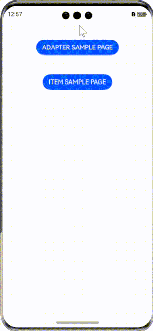

<div align="center">
<h1>RecyclerViewAnimators4cj</h1>
</div>

<p align="center">


</p>

## 介绍

RecyclerViewAnimators4cj 是基于Android 动画库 [recyclerview-animators](https://github.com/wasabeef/recyclerview-animators) 的 Cangjie 移植版本，用于添加动画效果。

### 特性

- 🚀 带有添加删除动画效果以及整体动画效果的list组件库
- 🚀 支持多种动画效果，如淡入淡出、缩放、滑动等


## 软件架构

### 源码目录

```shell
├─AppScope
├─doc
├─entry
│  └─src
│      └─main
│          ├─cangjie
│          └─resources
├─recyclerview
│  └─src
│      └─main
│          ├─cangjie
│          │  └─src
│          └─resources
└─hvigor

```

- `AppScope` 全局资源存放目录和应用全局信息配置目录
- `doc` API文档和使用手册存放目录
- `entry` 工程模块 - 编译生成一个HAP
- `entry src` APP代码目录
- `entry src main` APP项目目录
- `entry src main cangjie` 仓颉代码目录
- `entry src main resources` 资源文件目录
- `recyclerview` 工程模块 - 编译生成一个har包
- `recyclerview src` 模块代码目录
- `recyclerview src main` 模块项目目录
- `recyclerview src main cangjie` 仓颉代码目录
- `recyclerview src main resources` 资源文件目录
- `hvigor` 构建工具目录

### 接口说明

主要类和函数接口说明详见 [API](doc/feature_api.md)

## 使用说明

### 编译构建

1. 通过module引入
    1. 克隆下载项目
    2. 将library模块拷贝到应用项目下
    3. 修改自身应用 entry 下的 oh-package.json5 文件，在 dependencies 字段添加 "recyclerview": "file:../recyclerview"
       ```json
       {
          "name": "entry",
          "version": "1.0.0",
          "description": "Please describe the basic information.",
          "main": "",
          "author": "",
          "license": "",
         "dependencies": {
             "recyclerview": "file:../recyclerview"
         }
       }
       ```
    4. 修改自身应用 entry/src/main/cangjie 下的 cjpm.toml 文件，在 [dependencies] 字段下添加
        ``` toml
        [dependencies.recyclerview]
          path = "../../../../recyclerview/src/main/cangjie"
          version = "1.0.0"
        ```
       toml变为
        ``` toml
        [dependencies]
          [dependencies.cj_res_entry]
            path = "./cj_res"
            version = "1.0.0"
          [dependencies.recyclerview]
            path = "../../../../recyclerview/src/main/cangjie"
            version = "1.0.0"
        ```
    5. 在项目中使用 import recyclerview.* 引用该项目
       ```cangjie
       import recyclerview.*
       ```
### 预览效果



### 功能示例
```cangjie

@Entry
@Component
class TestExample {
    var listDatas: ObservedArrayList<String> = ObservedArrayList<String>(
        ["Apple", "Ball", "Camera", "Day", "Egg", "Foo", "GL", "Hello", "Iron", "Japan", "Coke", "Dog", "Cat", "Yahoo",
        "Sony", "Canon", "Fujitsu", "USA", "Nexus", "LINE", "Haskell", "C++", "Java", "Go", "Swift", "Objective-c",
        "Ruby", "PHP", "Bash", "ksh", "C", "Groovy", "Kotlin", "Chip", "Japan", "U.S.A", "San Francisco", "Paris",
        "Tokyo", "Silicon Valley", "London", "Spain", "China", "Taiwan", "Asia", "New York", "France", "Kyoto", "AD",
        "GL", "iPhone", "iPad", "iPod", "Wasabeef"]);

    @State
    var controller: Controller = Controller()
    @State
    var selectIndex: Int32 = 0

    protected override func aboutToAppear() {
        this.controller.setItemAnimation(ItemAnimationType.Default)
        this.controller.setAdapterAnimation(AdapterAnimationType.AlphaIn)
        this.controller.setFirstOnly(false)
        this.controller.setDuration(500)
    }

    func build() {
        Column() {
            RecyclerView(
                array: this.listDatas,
                controller: this.controller,
                child: this.SpecificChild,
                columnsNum: 1
            )
        }
    }

    @Builder
    func SpecificChild(itemData: String) {
        Column() {
            Image(@r(app.media.sample)).width(100.percent).height(100)
            Text(itemData + '').fontSize(20).textAlign(TextAlign.Center).width(100.percent)
        }.margin(10)
    }
}
```

## 约束与限制

1. 当前基于 deveco-studio-5.0.3.910 版本实现

## 开源协议

本项目基于 [Apache License 2.0](./LICENSE) ，请自由的享受和参与开源。

## 参与贡献

欢迎给我们提交PR，欢迎给我们提交Issue，欢迎参与任何形式的贡献。

